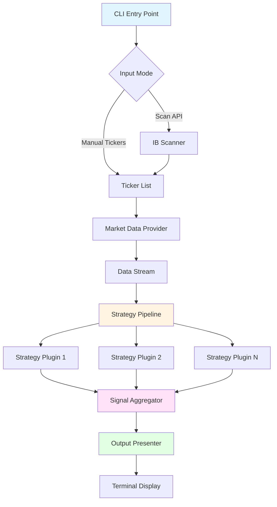
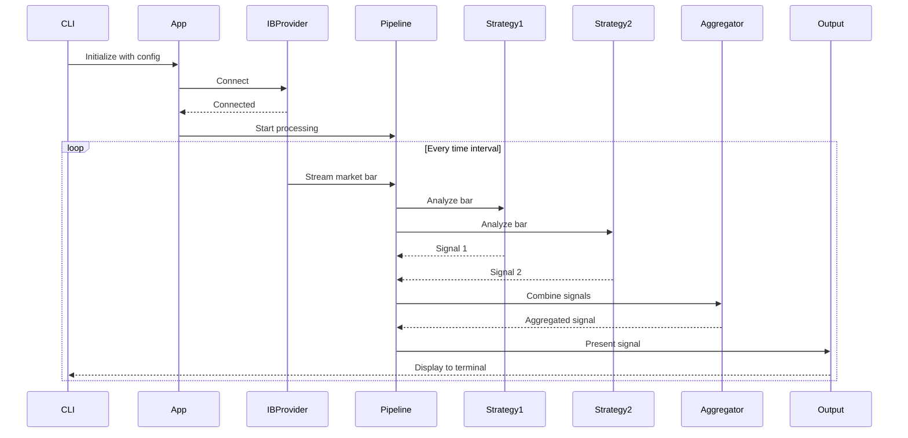

# Power Trader - Architecture Plan

## Overview

A Python-based day trading system built as a monorepo using uv, featuring a clean separation between framework (protocols/abstractions) and application logic (Interactive Brokers integration). The system uses plugin architecture for ML strategies and automatic dependency injection.

**Framework**: Architecture-agnostic protocols and abstractions
**Trading App**: Hexagonal Architecture (Ports & Adapters)
**Future Apps**: Can use layered, event-driven, or other architectures

## Technology Stack

- **Package Manager**: uv (workspace support)
- **Type Checker**: mypy (strict mode)
- **Linter**: ruff
- **Dependency Injection**: that-depends (constructor injection with type hints)
- **Data Validation**: Pydantic (for models where performance allows)
- **Testing**: pytest
- **Version Control**: git

## Monorepo Structure

```
power_trader/
├── pyproject.toml                 # Workspace root configuration
├── uv.lock                        # Lockfile for all workspace members
├── .gitignore
├── README.md
├── mypy.ini                       # Shared mypy configuration
├── ruff.toml                      # Shared ruff configuration
├── pytest.ini                     # Shared pytest configuration
│
├── packages/
│   ├── framework/                 # Project 1: Core framework
│   │   ├── pyproject.toml
│   │   ├── README.md
│   │   ├── src/
│   │   │   └── power_trader_framework/
│   │   │       ├── __init__.py
│   │   │       ├── protocols/     # All protocol definitions
│   │   │       │   ├── __init__.py
│   │   │       │   ├── data.py            # Market data protocols
│   │   │       │   ├── strategy.py        # ML strategy protocols
│   │   │       │   ├── output.py          # Output/presentation protocols
│   │   │       │   ├── lifecycle.py       # Application lifecycle protocols
│   │   │       │   └── config.py          # Configuration protocols
│   │   │       ├── core/          # Core framework components
│   │   │       │   ├── __init__.py
│   │   │       │   ├── di_container.py    # DI registration & setup
│   │   │       │   ├── application.py     # Application bootstrap
│   │   │       │   ├── plugin_loader.py   # Plugin discovery & loading
│   │   │       │   └── exceptions.py      # Framework exceptions
│   │   │       ├── types/         # Common types and enums
│   │   │       │   ├── __init__.py
│   │   │       │   ├── market.py          # Market data types
│   │   │       │   ├── signals.py         # Signal types
│   │   │       │   └── common.py          # Common enums & types
│   │   │       └── py.typed        # PEP 561 marker
│   │   └── tests/
│   │       ├── __init__.py
│   │       ├── test_di_container.py
│   │       ├── test_application.py
│   │       └── test_plugin_loader.py
│   │
│   ├── trading-app/              # Project 2: Trading application
│   │   ├── pyproject.toml
│   │   ├── README.md
│   │   ├── src/
│   │   │   └── power_trader_app/
│   │   │       ├── __init__.py
│   │   │       ├── main.py               # Entry point
│   │   │       ├── cli.py                # CLI interface
│   │   │       ├── config/
│   │   │       │   ├── __init__.py
│   │   │       │   ├── settings.py       # Pydantic settings
│   │   │       │   └── default.toml      # Default configuration
│   │   │       ├── providers/
│   │   │       │   ├── __init__.py
│   │   │       │   ├── ib_provider.py    # Interactive Brokers impl
│   │   │       │   └── ib_scanner.py     # Stock scanner impl
│   │   │       ├── output/
│   │   │       │   ├── __init__.py
│   │   │       │   └── terminal_output.py # Terminal presenter
│   │   │       ├── orchestration/
│   │   │       │   ├── __init__.py
│   │   │       │   ├── trading_pipeline.py # Main pipeline
│   │   │       │   └── signal_aggregator.py # Signal aggregation
│   │   │       └── py.typed
│   │   └── tests/
│   │       ├── __init__.py
│   │       ├── test_ib_provider.py
│   │       ├── test_pipeline.py
│   │       └── fixtures/
│   │           └── mock_data.py
│   │
│   ├── strategy-momentum/        # Example ML strategy plugin
│   │   ├── pyproject.toml
│   │   ├── README.md
│   │   ├── src/
│   │   │   └── power_trader_strategy_momentum/
│   │   │       ├── __init__.py
│   │   │       ├── strategy.py   # Momentum strategy implementation
│   │   │       └── models.py     # ML models (if any)
│   │   └── tests/
│   │       └── test_strategy.py
│   │
│   ├── strategy-volume-profile/  # Another ML strategy plugin
│   │   ├── pyproject.toml
│   │   ├── README.md
│   │   ├── src/
│   │   │   └── power_trader_strategy_volume_profile/
│   │   │       ├── __init__.py
│   │   │       └── strategy.py
│   │   └── tests/
│   │       └── test_strategy.py
│   │
│   └── cli-tools/                # CLI tool for scaffolding
│       ├── pyproject.toml
│       ├── README.md
│       ├── src/
│       │   └── power_trader_cli/
│       │       ├── __init__.py
│       │       ├── main.py       # CLI entry point
│       │       ├── commands/
│       │       │   ├── __init__.py
│       │       │   ├── create_app.py     # App generator
│       │       │   └── create_strategy.py # Strategy generator
│       │       └── templates/    # Jinja2 templates for scaffolding
│       │           ├── app/
│       │           └── strategy/
│       └── tests/
│           └── test_commands.py
│
└── docs/                          # Additional documentation
    ├── getting_started.md
    ├── creating_strategies.md
    └── ib_setup.md
```

## Core Framework Design (Project 1)

### 1. Protocols

#### Market Data Protocol ([`protocols/data.py`](packages/framework/src/power_trader_framework/protocols/data.py))

```python
from typing import Protocol, AsyncIterator
from datetime import datetime
from power_trader_framework.types.market import MarketBar, TickerSymbol, TimeInterval

class IMarketDataProvider(Protocol):
    """Protocol for market data providers (Interactive Brokers, etc.)"""
    
    async def connect(self) -> None:
        """Establish connection to data provider"""
        ...
    
    async def disconnect(self) -> None:
        """Close connection to data provider"""
        ...
    
    async def stream_bars(
        self,
        symbols: list[TickerSymbol],
        interval: TimeInterval
    ) -> AsyncIterator[MarketBar]:
        """Stream real-time market bars for given symbols"""
        ...
    
    async def get_historical_bars(
        self,
        symbol: TickerSymbol,
        interval: TimeInterval,
        start: datetime,
        end: datetime
    ) -> list[MarketBar]:
        """Retrieve historical market bars"""
        ...


class IMarketScanner(Protocol):
    """Protocol for scanning/discovering tradeable securities"""
    
    async def scan_by_criteria(
        self,
        min_volume: int | None = None,
        min_price: float | None = None,
        max_price: float | None = None,
        sector: str | None = None
    ) -> list[TickerSymbol]:
        """Scan market for stocks matching criteria"""
        ...
```

#### Strategy Protocol ([`protocols/strategy.py`](packages/framework/src/power_trader_framework/protocols/strategy.py))

```python
from typing import Protocol
from power_trader_framework.types.market import MarketBar
from power_trader_framework.types.signals import TradingSignal, SignalMetadata

class IStrategy(Protocol):
    """Protocol for ML trading strategies (plugins)"""
    
    @property
    def strategy_name(self) -> str:
        """Unique identifier for this strategy"""
        ...
    
    @property
    def version(self) -> str:
        """Strategy version"""
        ...
    
    async def analyze(self, bars: list[MarketBar]) -> TradingSignal:
        """
        Analyze market data and generate trading signal
        
        Returns signal with BUY, HOLD, or SELL recommendation
        with confidence score and metadata
        """
        ...
    
    async def initialize(self) -> None:
        """Initialize strategy (load models, etc.)"""
        ...
    
    async def cleanup(self) -> None:
        """Cleanup resources"""
        ...


class ISignalAggregator(Protocol):
    """Protocol for aggregating signals from multiple strategies"""
    
    def aggregate_signals(
        self,
        signals: list[TradingSignal]
    ) -> TradingSignal:
        """Combine multiple strategy signals into one"""
        ...
```

#### Output Protocol ([`protocols/output.py`](packages/framework/src/power_trader_framework/protocols/output.py))

```python
from typing import Protocol
from power_trader_framework.types.signals import TradingSignal, SignalMetadata
from power_trader_framework.types.market import TickerSymbol

class IOutputPresenter(Protocol):
    """Protocol for presenting trading signals (terminal, UI, etc.)"""
    
    async def present_signal(
        self,
        symbol: TickerSymbol,
        signal: TradingSignal,
        metadata: SignalMetadata
    ) -> None:
        """Present a trading signal to the user"""
        ...
    
    async def present_error(self, error: Exception) -> None:
        """Present an error to the user"""
        ...
    
    async def present_status(self, message: str) -> None:
        """Present a status message"""
        ...
```

#### Lifecycle Protocol ([`protocols/lifecycle.py`](packages/framework/src/power_trader_framework/protocols/lifecycle.py))

```python
from typing import Protocol

class IApplicationLifecycle(Protocol):
    """Protocol for application lifecycle management"""
    
    async def startup(self) -> None:
        """Execute startup sequence"""
        ...
    
    async def shutdown(self) -> None:
        """Execute shutdown sequence"""
        ...


class IHealthCheck(Protocol):
    """Protocol for health checks"""
    
    async def check_health(self) -> bool:
        """Return True if component is healthy"""
        ...
```

#### Configuration Protocol ([`protocols/config.py`](packages/framework/src/power_trader_framework/protocols/config.py))

```python
from typing import Protocol, Any

class IConfigProvider(Protocol):
    """Protocol for configuration management"""
    
    def get(self, key: str, default: Any = None) -> Any:
        """Get configuration value"""
        ...
    
    def get_section(self, section: str) -> dict[str, Any]:
        """Get entire configuration section"""
        ...
```

### 2. Types

#### Market Types ([`types/market.py`](packages/framework/src/power_trader_framework/types/market.py))

```python
from dataclasses import dataclass
from datetime import datetime
from decimal import Decimal

@dataclass(frozen=True, slots=True)
class TickerSymbol:
    """Immutable ticker symbol representation"""
    symbol: str
    exchange: str | None = None
    
    def __str__(self) -> str:
        return f"{self.symbol}:{self.exchange}" if self.exchange else self.symbol


@dataclass(frozen=True, slots=True)
class MarketBar:
    """OHLCV bar data - using dataclass for performance"""
    symbol: TickerSymbol
    timestamp: datetime
    open: Decimal
    high: Decimal
    low: Decimal
    close: Decimal
    volume: int
    
    def __post_init__(self) -> None:
        # Validation
        if self.high < self.low:
            raise ValueError("High must be >= low")


@dataclass(frozen=True, slots=True)
class TimeInterval:
    """Time interval representation"""
    seconds: int
    
    @classmethod
    def from_minutes(cls, minutes: int) -> "TimeInterval":
        return cls(seconds=minutes * 60)
    
    @classmethod
    def from_seconds(cls, seconds: int) -> "TimeInterval":
        return cls(seconds=seconds)
```

#### Signal Types ([`types/signals.py`](packages/framework/src/power_trader_framework/types/signals.py))

```python
from dataclasses import dataclass
from datetime import datetime
from enum import Enum
from typing import Any

class SignalType(str, Enum):
    """Trading signal types"""
    BUY = "buy"
    SELL = "sell"
    HOLD = "hold"


@dataclass(frozen=True, slots=True)
class TradingSignal:
    """Trading signal from strategy"""
    signal_type: SignalType
    confidence: float  # 0.0 to 1.0
    timestamp: datetime
    strategy_name: str
    metadata: dict[str, Any]
    
    def __post_init__(self) -> None:
        if not 0.0 <= self.confidence <= 1.0:
            raise ValueError("Confidence must be between 0.0 and 1.0")


@dataclass
class SignalMetadata:
    """Additional metadata about signal generation"""
    bars_analyzed: int
    computation_time_ms: float
    indicators: dict[str, float]
```

### 3. Dependency Injection System

#### DI Container ([`core/di_container.py`](packages/framework/src/power_trader_framework/core/di_container.py))

```python
from that_depends import BaseContainer, providers
from typing import TypeVar, Type

T = TypeVar('T')

class DIContainer(BaseContainer):
    """
    Dependency injection container using that-depends
    
    Supports automatic constructor injection based on type hints
    """
    
    def register_singleton(self, interface: Type[T], implementation: Type[T]) -> None:
        """Register a singleton implementation for an interface"""
        ...
    
    def register_transient(self, interface: Type[T], implementation: Type[T]) -> None:
        """Register a transient (new instance each time) implementation"""
        ...
    
    def register_factory(self, interface: Type[T], factory: callable) -> None:
        """Register a factory function for creating instances"""
        ...
    
    def resolve(self, interface: Type[T]) -> T:
        """Resolve an implementation for an interface"""
        ...


class PluginRegistry:
    """
    Registry for strategy plugins
    
    Automatically discovers and registers strategies from installed packages
    """
    
    def __init__(self, container: DIContainer) -> None:
        self.container = container
        self._strategies: dict[str, Type] = {}
    
    def discover_strategies(self) -> None:
        """Discover strategies using entry points"""
        ...
    
    def register_strategy(self, strategy_class: Type) -> None:
        """Manually register a strategy"""
        ...
    
    def get_all_strategies(self) -> list[Type]:
        """Get all registered strategy classes"""
        ...
```

### 4. Application Bootstrap ([`core/application.py`](packages/framework/src/power_trader_framework/core/application.py))

```python
from typing import Callable, Awaitable
from power_trader_framework.core.di_container import DIContainer
from power_trader_framework.protocols.lifecycle import IApplicationLifecycle

class Application:
    """
    Main application class for bootstrapping and lifecycle management
    """
    
    def __init__(self, container: DIContainer) -> None:
        self.container = container
        self._startup_hooks: list[Callable[[], Awaitable[None]]] = []
        self._shutdown_hooks: list[Callable[[], Awaitable[None]]] = []
    
    def on_startup(self, func: Callable[[], Awaitable[None]]) -> None:
        """Register a startup hook"""
        self._startup_hooks.append(func)
    
    def on_shutdown(self, func: Callable[[], Awaitable[None]]) -> None:
        """Register a shutdown hook"""
        self._shutdown_hooks.append(func)
    
    async def start(self) -> None:
        """Start the application"""
        for hook in self._startup_hooks:
            await hook()
    
    async def stop(self) -> None:
        """Stop the application"""
        for hook in reversed(self._shutdown_hooks):
            await hook()
    
    async def run(self) -> None:
        """Run the application (start, wait, stop)"""
        ...
```

## Trading Application Design (Project 2)

### System Flow



### Component Interaction



### Key Components

#### Secondary Adapter: Interactive Brokers Provider ([`adapters/secondary/ib_provider.py`](packages/trading-app/src/power_trader_app/adapters/secondary/ib_provider.py))

```python
from ib_insync import IB, Stock, util
from power_trader_framework.protocols.data import IMarketDataProvider
from power_trader_framework.types.market import MarketBar, TickerSymbol, TimeInterval

class InteractiveBrokersAdapter:
    """
    Secondary adapter - implements IMarketDataProvider port
    
    Adapts Interactive Brokers API to our domain interface
    Core business logic has no knowledge of IB-specific details
    """
    
    def __init__(self, host: str, port: int, client_id: int) -> None:
        self._ib = IB()
        self._host = host
        self._port = port
        self._client_id = client_id
    
    async def connect(self) -> None:
        await self._ib.connectAsync(self._host, self._port, self._client_id)
    
    async def stream_bars(
        self,
        symbols: list[TickerSymbol],
        interval: TimeInterval
    ) -> AsyncIterator[MarketBar]:
        # Adapter logic: Convert IB data to domain MarketBar objects
        for symbol in symbols:
            stock = Stock(symbol.symbol, 'SMART', 'USD')
            bars = self._ib.reqHistoricalData(
                stock,
                endDateTime='',
                durationStr='1 D',
                barSizeSetting=f'{interval.seconds} secs',
                whatToShow='TRADES',
                useRTH=True
            )
            # Convert IB bar to domain MarketBar
            for bar in bars:
                yield MarketBar(
                    symbol=symbol,
                    timestamp=bar.date,
                    open=Decimal(str(bar.open)),
                    high=Decimal(str(bar.high)),
                    low=Decimal(str(bar.low)),
                    close=Decimal(str(bar.close)),
                    volume=bar.volume
                )
```

### Why Hexagonal for Trading App?

**Benefits:**
1. **Business Logic Isolation** - Core use cases don't depend on IB, CLI, or terminal
2. **Easy Testing** - Mock all ports to test use cases in isolation
3. **Flexibility** - Swap IB for another broker without touching core
4. **Future-Proof** - Add REST API or Web UI without modifying use cases

**Other Apps Can Use Different Architectures:**
- Simple utility app → Layered architecture
- Event processing app → Event-driven architecture
- Data pipeline app → Pipe and filter architecture

The framework's protocol-based design supports all architectural styles!

#### Trading Pipeline ([`orchestration/trading_pipeline.py`](packages/trading-app/src/power_trader_app/orchestration/trading_pipeline.py))

```python
from power_trader_framework.protocols.data import IMarketDataProvider
from power_trader_framework.protocols.strategy import IStrategy, ISignalAggregator
from power_trader_framework.protocols.output import IOutputPresenter

class TradingPipeline:
    """
    Main orchestration component that coordinates data flow
    
    Dependencies injected via constructor with type hints
    """
    
    def __init__(
        self,
        data_provider: IMarketDataProvider,
        strategies: list[IStrategy],
        aggregator: ISignalAggregator,
        output: IOutputPresenter
    ) -> None:
        self._data_provider = data_provider
        self._strategies = strategies
        self._aggregator = aggregator
        self._output = output
    
    async def run(self, symbols: list[TickerSymbol], interval: TimeInterval) -> None:
        """Main pipeline execution"""
        async for bar in self._data_provider.stream_bars(symbols, interval):
            signals = []
            for strategy in self._strategies:
                signal = await strategy.analyze([bar])
                signals.append(signal)
            
            aggregated = self._aggregator.aggregate_signals(signals)
            await self._output.present_signal(bar.symbol, aggregated, metadata)
```

#### Configuration ([`config/settings.py`](packages/trading-app/src/power_trader_app/config/settings.py))

```python
from pydantic_settings import BaseSettings
from pydantic import Field

class InteractiveBrokersSettings(BaseSettings):
    """IB connection settings"""
    host: str = Field(default="127.0.0.1")
    port: int = Field(default=7497)
    client_id: int = Field(default=1)

class TradingSettings(BaseSettings):
    """Trading configuration"""
    default_interval_seconds: int = Field(default=60)
    max_concurrent_symbols: int = Field(default=10)
    
class Settings(BaseSettings):
    """Application settings using Pydantic"""
    ib: InteractiveBrokersSettings = InteractiveBrokersSettings()
    trading: TradingSettings = TradingSettings()
    
    class Config:
        env_prefix = "POWER_TRADER_"
        env_nested_delimiter = "__"
```

## ML Strategy Plugins

### Strategy Plugin Pattern

Each strategy is a separate package that:
1. Implements [`IStrategy`](packages/framework/src/power_trader_framework/protocols/strategy.py) protocol
2. Registers via entry points in pyproject.toml
3. Automatically discovered and loaded by the framework

### Example Strategy Structure

```python
# packages/strategy-momentum/src/power_trader_strategy_momentum/strategy.py

from power_trader_framework.protocols.strategy import IStrategy
from power_trader_framework.types.market import MarketBar
from power_trader_framework.types.signals import TradingSignal, SignalType

class MomentumStrategy:
    """
    Momentum-based strategy focusing on price trends
    
    Avoids signals based on:
    - Naked short selling indicators
    - Unusual activity flags
    """
    
    @property
    def strategy_name(self) -> str:
        return "momentum-v1"
    
    @property
    def version(self) -> str:
        return "1.0.0"
    
    async def analyze(self, bars: list[MarketBar]) -> TradingSignal:
        # Calculate momentum indicators
        # - RSI (Relative Strength Index)
        # - MACD (Moving Average Convergence Divergence)
        # - Volume-weighted average price
        
        # Generate signal based on technical indicators
        # Exclude signals when detecting:
        # - Abnormal short interest
        # - Unusual volume spikes
        
        return TradingSignal(
            signal_type=SignalType.BUY,
            confidence=0.85,
            timestamp=datetime.now(),
            strategy_name=self.strategy_name,
            metadata={"rsi": 65, "macd": 0.5}
        )
```

### Entry Point Registration

```toml
# packages/strategy-momentum/pyproject.toml

[project.entry-points."power_trader.strategies"]
momentum = "power_trader_strategy_momentum.strategy:MomentumStrategy"
```

## CLI Tool for Scaffolding

### Command Structure

```bash
# Create new trading app
power_trader create app my-custom-app

# Create new strategy plugin
power_trader create strategy my-strategy --template momentum

# List available templates
power_trader templates list
```

### Implementation

The CLI tool uses Jinja2 templates to generate:
- Complete package structure
- pyproject.toml with proper dependencies
- Boilerplate implementation code
- Test structure
- README

## Configuration Files

### Root [`pyproject.toml`](pyproject.toml)

```toml
[project]
name = "power-trader-workspace"
version = "0.1.0"
description = "Day trading system with ML strategies"
requires-python = ">=3.11"

[tool.uv.workspace]
members = [
    "packages/framework",
    "packages/trading-app",
    "packages/strategy-*",
    "packages/cli-tools"
]

[tool.uv.sources]
power-trader-framework = { workspace = true }
```

### Shared [`mypy.ini`](mypy.ini)

```ini
[mypy]
python_version = 3.11
strict = True
warn_return_any = True
warn_unused_configs = True
disallow_untyped_defs = True
disallow_any_unimported = True
no_implicit_optional = True
warn_redundant_casts = True
warn_unused_ignores = True
warn_no_return = True
check_untyped_defs = True
strict_equality = True
```

### Shared [`ruff.toml`](ruff.toml)

```toml
target-version = "py311"
line-length = 100

[lint]
select = [
    "E",   # pycodestyle errors
    "W",   # pycodestyle warnings
    "F",   # pyflakes
    "I",   # isort
    "B",   # flake8-bugbear
    "C4",  # flake8-comprehensions
    "UP",  # pyupgrade
    "ARG", # flake8-unused-arguments
    "SIM", # flake8-simplify
]
ignore = []

[lint.per-file-ignores]
"__init__.py" = ["F401"]
"tests/*" = ["ARG"]

[format]
quote-style = "double"
indent-style = "space"
```

### Shared [`pytest.ini`](pytest.ini)

```ini
[pytest]
testpaths = packages
python_files = test_*.py
python_classes = Test*
python_functions = test_*
addopts = 
    --strict-markers
    --strict-config
    --verbose
    --cov
    --cov-report=html
    --cov-report=term-missing
```

## Testing Strategy

### Unit Tests
- Test each protocol implementation in isolation
- Mock dependencies using protocols
- Focus on business logic and edge cases

### Integration Tests
- Test DI container resolution
- Test strategy loading and execution
- Test data provider integration

### End-to-End Tests
- Test full pipeline with mock IB provider
- Test multiple strategies with signal aggregation
- Test error handling and recovery

## SOLID Principles Application

1. **Single Responsibility**: Each component has one clear purpose
2. **Open/Closed**: Plugin architecture allows extension without modification
3. **Liskov Substitution**: All protocols can be substituted with implementations
4. **Interface Segregation**: Focused protocols (IMarketDataProvider, IStrategy, etc.)
5. **Dependency Inversion**: Depend on protocols, not concrete implementations

## Performance Considerations

1. **Data Classes vs Pydantic**:
   - Use dataclasses for high-frequency data (MarketBar, TimeInterval)
   - Use Pydantic for configuration and validation (Settings)

2. **Async/Await**:
   - All I/O operations are async
   - Strategies can process in parallel

3. **Memory Management**:
   - Use slots in dataclasses
   - Frozen dataclasses for immutability
   - Stream processing instead of batch loading

## Dependencies

### Framework
- that-depends (DI)
- typing-extensions (type hints)

### Trading App
- ib-insync (Interactive Brokers API)
- pydantic (configuration)
- pydantic-settings (settings management)

### Strategy Plugins
- numpy (numerical computation)
- pandas (data analysis)
- ta-lib or pandas-ta (technical indicators)
- scikit-learn (ML models, if needed)

### Development
- mypy (type checking)
- ruff (linting/formatting)
- pytest (testing)
- pytest-cov (coverage)
- pytest-asyncio (async testing)
- pytest-mock (mocking)

## Next Steps After Approval

1. Initialize uv workspace and git repository
2. Set up shared configuration files
3. Implement framework package (protocols and core)
4. Implement trading app with IB integration
5. Create example strategy plugins
6. Build CLI scaffolding tool
7. Write comprehensive tests
8. Create documentation and examples

## Notes

- Architecture remains flexible for hexagonal, layered, or event-based patterns
- All architectural decisions are captured in protocols, not concrete implementations
- Strategy plugins are completely independent and hot-swappable
- System designed for extensibility and testability
