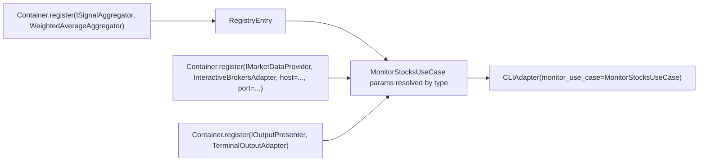

# Decoupled Container Register/Resolve API

## Goal

Replace the current that-depends class-attribute wiring in [`main.py`](../packages/power-day-trader/src/power_day_trader/main.py) with a clean, *interface-to-implementation* registration container. Resolving a type builds the dependency chain automatically from constructor type hints.

## Problem with current design

- [`TradingAppContainer`](../packages/power-day-trader/src/power_day_trader/main.py:17) hard-codes every provider as a class attribute with explicit keyword args (e.g. `cli_adapter = providers.Singleton(CLIAdapter, monitor_use_case=monitor_use_case)`).
- Adapters/use-cases must know the container class to resolve anything (service-locator coupling).
- No clean *"register interface -> implementation"* concept for swapping adapters.

## Target design

Introduce `Container` in `power-core` — a plain registry that maps an interface type to a lazy factory + lifetime. Resolving an object:
1. Looks at the requested type's constructor signature.
2. For each constructor parameter, resolves the registered binding by type.
3. Instantiates with those resolved dependencies.



### API surface

```python
container = Container()

# register interface -> implementation (+ optional kwargs passed to ctor)
container.register(ISignalAggregator, WeightedAverageAggregator)
container.register(IMarketDataProvider, InteractiveBrokersAdapter,
                   host=settings.ib.host, port=settings.ib.port, client_id=settings.ib.client_id)
container.register(IOutputPresenter, TerminalOutputAdapter)
container.register(IConfigProvider, ...)  # optional
container.register(str, PluginRegistry)    # strategies registry (named)

# register concrete types too (use cases, adapters)
container.register(MonitorStocksUseCase, MonitorStocksUseCase)
container.register(CLIAdapter, CLIAdapter)

# resolve a graph by type
cli: CLIAdapter = container.resolve(CLIAdapter)
```

- **Async-aware:** `resolve` is sync; `resolve_async` awaits async factories/hooks (connect, initialize) if needed.
- **Lifetimes:** default singleton (per-container cache); support `lifetime="transient"` for strategies.
- **Loose deps:** unmatched constructor params raise a clear `DIError` listing the missing type.
- **Keeps `PluginRegistry` decoupled:** plugins register implementations; container can inject them as `list[IStrategy]` via a provider callback.

## Files

| File | Change |
|------|--------|
| `packages/power-core/src/power_core/container.py` | New `Container` class (register/resolve). |
| `packages/power-core/src/power_core/di_container.py` | Keep `PluginRegistry`; `DIContainer` may alias/backport to `Container` for compatibility. |
| `packages/power-core/src/power_core/__init__.py` | Export `Container`. |
| `packages/power-day-trader/src/power_day_trader/main.py` | Rewrite container wiring using `Container.register(...)` + `container.resolve(CLIAdapter)`; drop `providers.Singleton` class attrs. |
| `packages/power-day-trader/tests/` | Add tests: register/resolve chain, missing-dep error, async/singleton behavior. |
| `packages/power-core/tests/` | Add unit tests for `Container`. |

## Cleanup risks

- `Application.__init__` takes `DIContainer`; must accept the new `Container` (or keep `DIContainer` as the base name of `Container`).
- Startup/shutdown hooks in `main.py` read `container.plugin_registry()` / `container.ib_provider()` — must become `container.resolve(...)`.
- Existing plans/architecture docs reference `DIContainer`; update naming in code, keep docs optional.