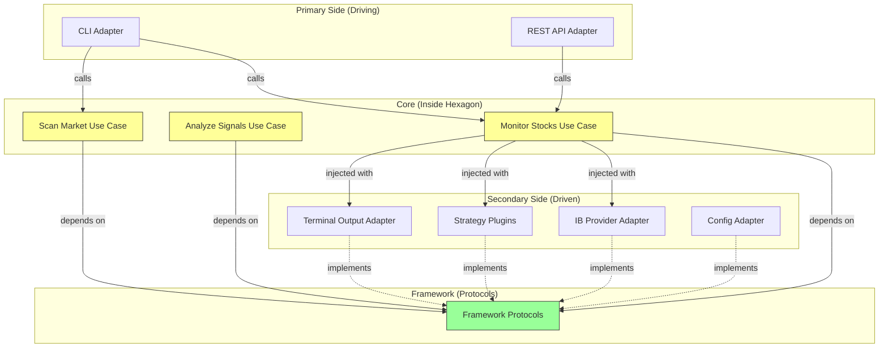

# Hexagonal Architecture for Trading App

## Overview

The trading application implements **Hexagonal Architecture (Ports & Adapters)** while the framework remains architecture-agnostic. This gives us maximum flexibility and testability.

## Architecture Layers

### Core/Domain (Inside the Hexagon)
**Location:** [`packages/trading-app/src/power_trader_app/core/`](../packages/trading-app/src/power_trader_app/core/)

**Purpose:** Contains pure business logic with zero dependencies on external systems

**Components:**
- **Use Cases** (`use_cases/`): Application-specific business rules
  - `MonitorStocksUseCase` - Main trading monitoring logic
  - `AnalyzeSignalsUseCase` - Signal analysis and decision making
  - `ScanMarketUseCase` - Market scanning logic

- **Domain Models** (`domain/`): Core business entities
  - Domain-specific rules and validations
  - Pure business logic without framework dependencies

**Dependencies:** Only framework protocols (which are just interfaces)

### Ports (Interfaces)

**Location:** [`packages/trading-app/src/power_trader_app/core/ports/`](../packages/trading-app/src/power_trader_app/core/ports/)

**Primary Ports (Driving):**
- How the outside world drives the application
- For trading app, the use cases ARE the primary ports
- External adapters call use cases directly

**Secondary Ports (Driven):**
- How the core interacts with external systems
- Re-export framework protocols:
  - `IMarketDataProvider` - For getting market data
  - `IStrategy` - For ML strategies
  - `IOutputPresenter` - For presenting results
  - `IConfigProvider` - For configuration

### Adapters (Implementations)

**Location:** [`packages/trading-app/src/power_trader_app/adapters/`](../packages/trading-app/src/power_trader_app/adapters/)

**Primary Adapters (Driving):**
- `cli_adapter.py` - Command-line interface
- `rest_adapter.py` - REST API (future)
- `web_adapter.py` - Web UI (future)

**Secondary Adapters (Driven):**
- `ib_provider.py` - Interactive Brokers adapter
- `ib_scanner.py` - Market scanning adapter
- `terminal_output.py` - Terminal display adapter
- `file_config.py` - File-based configuration adapter
- `signal_aggregator.py` - Signal aggregation adapter

## Folder Structure

```
packages/trading-app/
├── src/power_trader_app/
│   ├── core/                          # INSIDE THE HEXAGON
│   │   ├── use_cases/                 # Application business rules
│   │   │   ├── monitor_stocks.py      # Main use case
│   │   │   ├── analyze_signals.py
│   │   │   └── scan_market.py
│   │   ├── domain/                    # Domain models & services
│   │   │   ├── models.py
│   │   │   └── services.py
│   │   └── ports/                     # Interfaces
│   │       ├── primary/               # (Mostly empty, use cases are ports)
│   │       └── secondary/             # Re-export framework protocols
│   │           └── ports.py
│   │
│   ├── adapters/                      # OUTSIDE THE HEXAGON
│   │   ├── primary/                   # Driving adapters
│   │   │   ├── cli_adapter.py         # CLI entry point
│   │   │   └── rest_adapter.py        # (future)
│   │   └── secondary/                 # Driven adapters
│   │       ├── ib_provider.py         # IB data implementation
│   │       ├── ib_scanner.py          # IB scanner implementation
│   │       ├── terminal_output.py     # Terminal implementation
│   │       ├── file_config.py         # Config implementation
│   │       └── signal_aggregator.py   # Aggregation implementation
│   │
│   ├── config/                        # Configuration
│   │   ├── settings.py
│   │   └── default.toml
│   │
│   └── main.py                        # DI setup and wiring
```

## Dependency Flow



## Example: Monitor Stocks Use Case

### Core Use Case (Business Logic)

```python
# packages/trading-app/src/power_trader_app/core/use_cases/monitor_stocks.py

from power_framework.protocols.data import IMarketDataProvider
from power_framework.protocols.strategy import IStrategy, ISignalAggregator
from power_framework.protocols.output import IOutputPresenter

class MonitorStocksUseCase:
    """
    Pure business logic - no knowledge of:
    - Interactive Brokers
    - CLI implementation
    - Terminal formatting
    - Configuration format
    
    Only depends on protocols (interfaces)
    """
    
    def __init__(
        self,
        data_provider: IMarketDataProvider,  # Port (protocol)
        strategies: list[IStrategy],          # Port (protocol)
        aggregator: ISignalAggregator,        # Port (protocol)
        output: IOutputPresenter              # Port (protocol)
    ) -> None:
        self._data_provider = data_provider
        self._strategies = strategies
        self._aggregator = aggregator
        self._output = output
    
    async def execute(
        self,
        symbols: list[TickerSymbol],
        interval: TimeInterval
    ) -> None:
        """
        Business logic for monitoring stocks
        
        This is architecture-independent code
        """
        await self._output.present_status(
            f"Monitoring {len(symbols)} symbols at {interval.seconds}s intervals"
        )
        
        async for bar in self._data_provider.stream_bars(symbols, interval):
            # Apply all strategies
            signals = await self._analyze_with_strategies(bar)
            
            # Aggregate using business rules
            final_signal = self._aggregator.aggregate_signals(signals)
            
            # Present result
            await self._output.present_signal(
                bar.symbol,
                final_signal,
                self._create_metadata(signals)
            )
    
    async def _analyze_with_strategies(
        self,
        bar: MarketBar
    ) -> list[TradingSignal]:
        """Domain logic: Apply all strategies to a bar"""
        signals = []
        for strategy in self._strategies:
            signal = await strategy.analyze([bar])
            signals.append(signal)
        return signals
```

### Primary Adapter (CLI)

```python
# packages/trading-app/src/power_trader_app/adapters/primary/cli_adapter.py

import asyncio
import click
from power_trader_app.core.use_cases.monitor_stocks import MonitorStocksUseCase
from power_framework.types.market import TickerSymbol, TimeInterval

@click.group()
def cli():
    """Power Trader CLI"""
    pass

@cli.command()
@click.option('--symbols', multiple=True, required=True, help='Stock symbols to monitor')
@click.option('--interval', default=60, help='Time interval in seconds')
def monitor(symbols: tuple[str], interval: int):
    """
    Monitor stocks for trading signals
    
    This adapter is THIN - it just:
    1. Parses CLI arguments
    2. Converts to domain types
    3. Calls use case
    """
    # Get use case from DI container
    use_case = get_monitor_use_case()  # Injected
    
    # Convert CLI types to domain types
    ticker_symbols = [TickerSymbol(symbol=s) for s in symbols]
    time_interval = TimeInterval.from_seconds(interval)
    
    # Call use case (business logic)
    asyncio.run(use_case.execute(ticker_symbols, time_interval))

@cli.command()
@click.option('--min-volume', type=int, help='Minimum volume')
def scan(min_volume: int | None):
    """
    Scan market for trading opportunities
    """
    use_case = get_scan_market_use_case()  # Injected
    asyncio.run(use_case.execute(min_volume=min_volume))
```

### Secondary Adapter (IB Provider)

```python
# packages/trading-app/src/power_trader_app/adapters/secondary/ib_provider.py

from ib_insync import IB, Stock
from power_framework.protocols.data import IMarketDataProvider
from power_framework.types.market import MarketBar, TickerSymbol, TimeInterval

class InteractiveBrokersAdapter:
    """
    Secondary adapter - adapts IB API to our domain interface
    
    Core business logic has NO knowledge of:
    - ib_insync library
    - IB connection details
    - IB-specific data formats
    """
    
    def __init__(self, host: str, port: int, client_id: int) -> None:
        self._ib = IB()
        self._host = host
        self._port = port
        self._client_id = client_id
    
    async def connect(self) -> None:
        """Adapter-specific connection logic"""
        await self._ib.connectAsync(self._host, self._port, self._client_id)
    
    async def stream_bars(
        self,
        symbols: list[TickerSymbol],
        interval: TimeInterval
    ) -> AsyncIterator[MarketBar]:
        """
        Adapt IB data to domain MarketBar objects
        
        Translation layer between IB format and domain format
        """
        for symbol in symbols:
            # IB-specific code
            stock = Stock(symbol.symbol, 'SMART', 'USD')
            self._ib.qualifyContracts(stock)
            
            # Request real-time bars
            bars = self._ib.reqRealTimeBars(
                stock,
                barSize=interval.seconds,
                whatToShow='TRADES',
                useRTH=True
            )
            
            # Convert IB format to domain format
            async for ib_bar in bars:
                yield MarketBar(
                    symbol=symbol,
                    timestamp=ib_bar.time,
                    open=Decimal(str(ib_bar.open)),
                    high=Decimal(str(ib_bar.high)),
                    low=Decimal(str(ib_bar.low)),
                    close=Decimal(str(ib_bar.close)),
                    volume=ib_bar.volume
                )
```

## Dependency Injection Wiring

```python
# packages/trading-app/src/power_trader_app/main.py

from that_depends import providers, BaseContainer
from power_trader_app.core.use_cases.monitor_stocks import MonitorStocksUseCase
from power_trader_app.adapters.secondary.ib_provider import InteractiveBrokersAdapter
from power_trader_app.adapters.secondary.terminal_output import TerminalOutputAdapter
from power_trader_app.adapters.primary.cli_adapter import cli

class TradingAppContainer(BaseContainer):
    """
    Wire everything together
    
    This is where we decide:
    - Which adapters to use
    - How to configure them
    - What gets injected where
    """
    
    # Configuration
    config = providers.Singleton(load_config)
    
    # Secondary adapters (driven)
    ib_provider = providers.Singleton(
        InteractiveBrokersAdapter,
        host=config.provided.ib.host,
        port=config.provided.ib.port,
        client_id=config.provided.ib.client_id
    )
    
    terminal_output = providers.Singleton(TerminalOutputAdapter)
    
    signal_aggregator = providers.Singleton(SignalAggregator)
    
    # Strategy plugins (auto-discovered)
    strategies = providers.List(
        discover_strategy_plugins()
    )
    
    # Core use cases (business logic)
    monitor_use_case = providers.Singleton(
        MonitorStocksUseCase,
        data_provider=ib_provider,
        strategies=strategies,
        aggregator=signal_aggregator,
        output=terminal_output
    )

def main():
    """Entry point"""
    container = TradingAppContainer()
    
    # Inject use cases into CLI
    inject_use_cases(container)
    
    # Run CLI
    cli()
```

## Benefits of Hexagonal Architecture

### 1. Testability
```python
# Test use case with mock adapters
async def test_monitor_use_case():
    # Create mocks
    mock_provider = MockMarketDataProvider()
    mock_output = MockOutputPresenter()
    mock_strategies = [MockStrategy()]
    mock_aggregator = MockSignalAggregator()
    
    # Create use case with mocks (no real IB, no real terminal)
    use_case = MonitorStocksUseCase(
        data_provider=mock_provider,
        strategies=mock_strategies,
        aggregator=mock_aggregator,
        output=mock_output
    )
    
    # Test business logic in isolation
    await use_case.execute(symbols, interval)
    
    # Verify business rules
    assert mock_output.signals_presented == 10
```

### 2. Flexibility
Swap adapters without touching core:

```python
# Switch from IB to another broker
container.ib_provider = providers.Singleton(AlpacaAdapter)

# Switch from terminal to web UI
container.output = providers.Singleton(WebUIAdapter)

# Add REST API alongside CLI
rest_api = create_rest_api(container.monitor_use_case)
```

### 3. Independent Development
- Core team works on use cases
- IB team works on IB adapter
- UI team works on web adapter
- No conflicts, no coupling

### 4. Future-Proof
Add features without changing core:
- Add backtesting → Mock data provider with historical data
- Add paper trading → Add order execution adapter
- Add alerting → Add notification adapter
- Add API → Add REST adapter

## Comparison with Other Architectures

### Hexagonal (Trading App)
```
✅ Core isolated from external concerns
✅ Easy to test
✅ Easy to swap implementations
✅ Clear boundaries
⚠️ More initial setup
```

### Layered (Future Simple App)
```
✅ Simple and familiar
✅ Good for CRUD operations
⚠️ Can lead to tight coupling
⚠️ Hard to swap implementations
```

### Event-Driven (Future Backtesting App)
```
✅ Asynchronous processing
✅ Good for time-series data
✅ Scalable
⚠️ More complex
⚠️ Eventual consistency
```

All architectures work with the same framework protocols!

## Summary

1. **Framework** = Architecture-agnostic protocols
2. **Trading App** = Hexagonal architecture for maximum flexibility
3. **Future Apps** = Choose architecture that fits the use case
4. **Common Denominator** = Framework protocols work with all architectures
