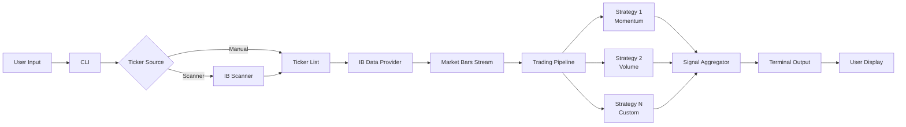

# Power Trader - Architecture Summary

## 📦 What We're Building

A professional day trading system with a clean, extensible architecture:

**Framework:** Architecture-agnostic protocols and abstractions
**Trading App:** Hexagonal Architecture (Ports & Adapters)
**Future Apps:** Can use layered, event-driven, or other architectures

```
┌─────────────────────────────────────────────────────────────┐
│              Power Trader System (Hexagonal)                 │
├─────────────────────────────────────────────────────────────┤
│                                                               │
│  PRIMARY ADAPTERS (Driving)        CORE DOMAIN               │
│  ┌───────────┐                  ┌──────────────┐           │
│  │    CLI    │─────────────────▶│  Use Cases   │           │
│  │  Adapter  │                  │              │           │
│  └───────────┘                  │ • Monitor    │           │
│                                  │   Stocks     │           │
│  ┌───────────┐                  │ • Analyze    │           │
│  │ REST API  │─────────────────▶│   Signals    │           │
│  │ (future)  │                  │ • Scan       │           │
│  └───────────┘                  │   Market     │           │
│                                  └───────┬──────┘           │
│                                          │                   │
│                     SECONDARY PORTS (Driven)                │
│                          │                                   │
│      ┌───────────────────┼────────────────────┐            │
│      │                   │                    │            │
│  ┌───▼────────┐  ┌──────▼──────┐  ┌─────────▼──────┐    │
│  │IB Provider │  │  Strategies │  │ Terminal Output │    │
│  │  Adapter   │  │   Plugins   │  │    Adapter      │    │
│  └────────────┘  └─────────────┘  └─────────────────┘    │
│                                                             │
│  ┌──────────────────────────────────────────────────┐     │
│  │       Framework (Architecture-Agnostic)          │     │
│  │  • Protocols for all ports                       │     │
│  │  • Dependency Injection                          │     │
│  │  • Plugin System                                 │     │
│  │  • Type System                                   │     │
│  └──────────────────────────────────────────────────┘     │
└─────────────────────────────────────────────────────────────┘
```

## 🎯 Key Design Decisions

### 1. Monorepo with uv
- Single repository with multiple packages
- Shared tooling configuration
- Easy cross-package development
- Unified dependency management

### 2. Protocol-Based Architecture
- **No concrete implementation in framework**
- Everything depends on protocols (interfaces)
- Easy to swap implementations
- Perfect for testing

### 3. Automatic Dependency Injection
- Using `that-depends` library
- Constructor injection only
- Type hints drive the injection
- No manual wiring needed

### 4. Plugin Architecture for Strategies
- Each ML strategy is a separate package
- Auto-discovered via entry points
- Hot-swappable
- Independent versioning

### 5. Strict Type Checking
- mypy in strict mode
- No `Any` types allowed
- Full IDE support
- Catch errors at compile time

## 📂 Package Breakdown

### Package 1: `framework` (Core Abstractions)
**Purpose:** Define all protocols and core types

**Key Components:**
- ✅ Market data protocols
- ✅ Strategy protocols
- ✅ Output protocols
- ✅ DI container setup
- ✅ Application lifecycle
- ✅ Plugin loader

**Dependencies:** Minimal (only `that-depends`)

**Why separate?** Keeps business logic independent of technology choices.

### Package 2: `trading-app` (Main Application)
**Purpose:** Interactive Brokers integration using Hexagonal Architecture

**Architecture:** Hexagonal (Ports & Adapters)
- **Core/Domain:** Use cases and business logic (architecture-independent)
- **Ports:** Interfaces defined by framework protocols
- **Adapters:**
  - Primary (Driving): CLI, REST API (future), Web UI (future)
  - Secondary (Driven): IB Provider, Terminal Output, Config, Strategies

**Key Components:**
- ✅ Core use cases (monitor stocks, analyze signals, scan market)
- ✅ Primary adapters (CLI)
- ✅ Secondary adapters (IB provider, terminal output, signal aggregator)
- ✅ Configuration management

**Dependencies:** `framework`, `ib-insync`, `pydantic`

**Why Hexagonal?**
- Business logic isolated from external concerns
- Easy to test with mock adapters
- Can swap IB for another broker without touching core
- Ready to add REST API or Web UI without modifying use cases

### Packages 3-N: `strategy-*` (ML Strategies)
**Purpose:** Individual trading strategies as plugins

**Examples:**
- `strategy-momentum` - RSI, MACD-based signals
- `strategy-volume-profile` - Volume analysis
- Future: `strategy-ml-lstm`, `strategy-order-flow`, etc.

**Key Feature:** Each strategy is completely independent and can be:
- Developed separately
- Tested separately
- Versioned separately
- Distributed separately

### Package: `cli-tools` (Developer Tools)
**Purpose:** Scaffolding and code generation

**Commands:**
```bash
power-trader create app my-custom-app
power-trader create strategy my-strategy
```

Generates complete boilerplate with:
- Correct folder structure
- Type-checked code
- Tests
- Documentation

## 🔄 Data Flow



## 🏗️ SOLID Principles in Action

### Single Responsibility
- `IMarketDataProvider` only provides data
- `IStrategy` only analyzes and signals
- `IOutputPresenter` only presents results
- Each has one reason to change

### Open/Closed
- Framework is closed to modification
- Open for extension via plugins
- New strategies don't require framework changes

### Liskov Substitution
- Any `IStrategy` implementation works
- Any `IMarketDataProvider` works (IB, mock, future providers)
- Protocols ensure compatibility

### Interface Segregation
- Small, focused protocols
- Components only depend on what they need
- No fat interfaces

### Dependency Inversion
- High-level modules (pipeline) depend on protocols
- Low-level modules (IB provider) implement protocols
- Both depend on abstractions

## 🚀 Workflow Example

### User Starts the App
```bash
uv run power-trader-app --symbols AAPL MSFT --interval 60
```

### What Happens

1. **Application Bootstrap**
   - Load configuration
   - Initialize DI container
   - Register all implementations
   - Discover and load strategy plugins

2. **Connection**
   - Connect to Interactive Brokers
   - Validate symbols
   - Subscribe to data streams

3. **Main Loop** (every interval, e.g., 60 seconds)
   ```
   Receive bar → Pass to each strategy → Aggregate signals → Display
   ```

4. **Output** (terminal for now)
   ```
   ┌────────────────────────────────────────────────────────┐
   │ AAPL | BUY | Confidence: 85% | Time: 14:30:00        │
   │ Strategies: momentum(0.9) volume(0.8)                  │
   │ RSI: 65 | MACD: 0.5 | Volume: Above Avg               │
   └────────────────────────────────────────────────────────┘
   ```

## 🎨 Design Patterns Used

1. **Strategy Pattern** - Multiple interchangeable strategies
2. **Observer Pattern** - React to market data events
3. **Dependency Injection** - Constructor injection throughout
4. **Plugin Pattern** - Dynamic strategy loading
5. **Repository Pattern** - Abstract data access (IB provider)
6. **Factory Pattern** - Create strategies from plugins
7. **Template Method** - Application lifecycle hooks

## ⚡ Performance Strategy

### Fast Path (Hot Loop)
- Use `dataclasses` with `slots` and `frozen`
- No Pydantic validation in hot path
- Async I/O throughout
- Parallel strategy execution

### Slower Path (Configuration, Setup)
- Use Pydantic for validation
- Full type checking
- Comprehensive error handling

### Memory Management
- Immutable data structures (frozen dataclasses)
- Streaming data (AsyncIterator)
- No unnecessary data buffering
- Clear lifecycle management

## 🧪 Testing Approach

### Unit Tests (90%+ coverage)
```python
def test_momentum_strategy():
    strategy = MomentumStrategy()
    bars = create_test_bars()  # Mock data
    signal = await strategy.analyze(bars)
    assert signal.signal_type == SignalType.BUY
```

### Integration Tests
```python
async def test_pipeline_with_strategies():
    container = DIContainer()
    # Register all real implementations
    pipeline = container.resolve(TradingPipeline)
    # Test with mock IB provider
```

### End-to-End Tests
```python
async def test_full_system():
    # Run actual CLI command with mock data
    # Verify complete flow
```

## 📋 Configuration Example

```toml
# config.toml
[ib]
host = "127.0.0.1"
port = 7497
client_id = 1

[trading]
default_interval_seconds = 60
max_concurrent_symbols = 10

[strategies]
enabled = ["momentum", "volume-profile"]

[strategies.momentum]
rsi_period = 14
macd_fast = 12
macd_slow = 26

[output]
format = "terminal"  # Future: "web", "json"
color = true
```

## 🔧 Development Workflow

### Adding a New Strategy

1. **Create plugin package**
   ```bash
   power-trader create strategy my-cool-strategy
   ```

2. **Implement the strategy**
   ```python
   class MyCoolStrategy:
       async def analyze(self, bars: list[MarketBar]) -> TradingSignal:
           # Your logic here
           return TradingSignal(...)
   ```

3. **Register via entry point** (auto-generated)
   ```toml
   [project.entry-points."power_trader.strategies"]
   my-cool = "my_cool_strategy:MyCoolStrategy"
   ```

4. **Test it**
   ```bash
   pytest packages/strategy-my-cool/
   ```

5. **Use it**
   ```bash
   uv run power-trader-app --strategies my-cool
   ```

## 🎓 Why This Architecture?

### For You (Developer)
- ✅ Easy to understand and modify
- ✅ Type-safe (no runtime type errors)
- ✅ Well-tested (confidence in changes)
- ✅ Fast iteration (change strategies without touching core)

### For Future You
- ✅ Easy to add new strategies
- ✅ Easy to swap data providers
- ✅ Easy to add UI layer
- ✅ Easy to add new output formats

### For Future Features
- ✅ Web UI - just implement `IOutputPresenter`
- ✅ New broker - just implement `IMarketDataProvider`
- ✅ Backtesting - mock data provider with historical data
- ✅ Real trading - add `IOrderExecutor` protocol

## 📈 Migration Path to Advanced Features

### Phase 1: MVP (Current Plan)
- Terminal output
- Manual ticker input
- Basic strategies
- IB data feed

### Phase 2: Enhanced (Future)
- Web UI
- Real-time dashboard
- Advanced strategies (ML models)
- Alert system

### Phase 3: Production (Future)
- Risk management
- Position sizing
- Order execution
- Performance analytics
- Backtesting engine

**The architecture supports all phases without major refactoring!**

## ✅ What's Next?

If you approve this architecture, I'll switch to **Code mode** to implement:

1. ✅ Initialize git and uv workspace
2. ✅ Create all configuration files
3. ✅ Implement framework package
4. ✅ Implement trading-app package
5. ✅ Create example strategy plugins
6. ✅ Build CLI scaffolding tool
7. ✅ Write comprehensive tests
8. ✅ Complete documentation

## 📖 Documentation You'll Get

- Comprehensive READMEs for each package
- Getting started guide
- Strategy development guide
- IB setup instructions
- API documentation
- Architecture diagrams

## 🤔 Questions or Changes?

Before we start implementation, is there anything you'd like to:
- Change in the architecture?
- Add to the system?
- Remove from the scope?
- Clarify about the design?

Otherwise, I'm ready to start building! 🚀
